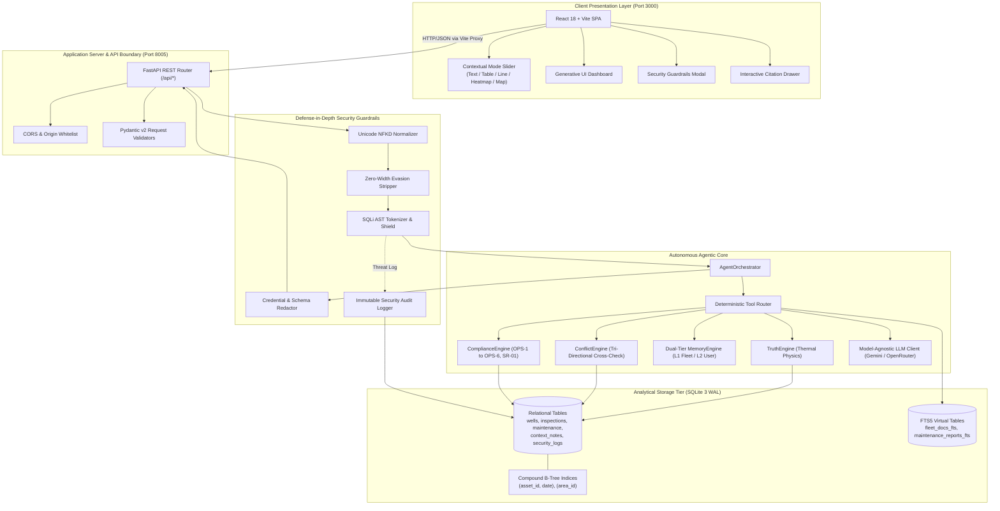
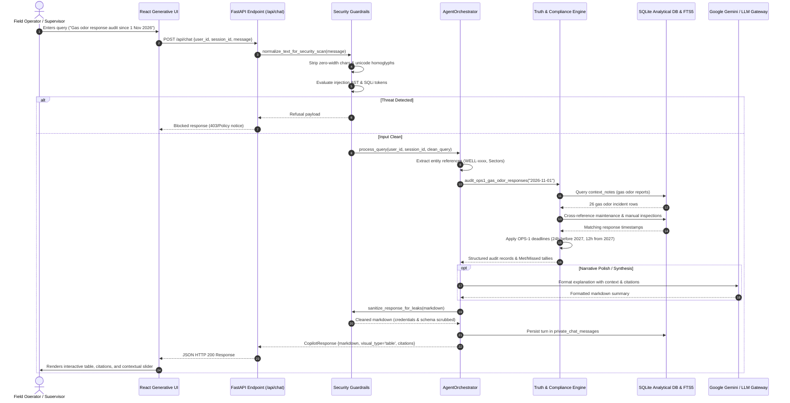
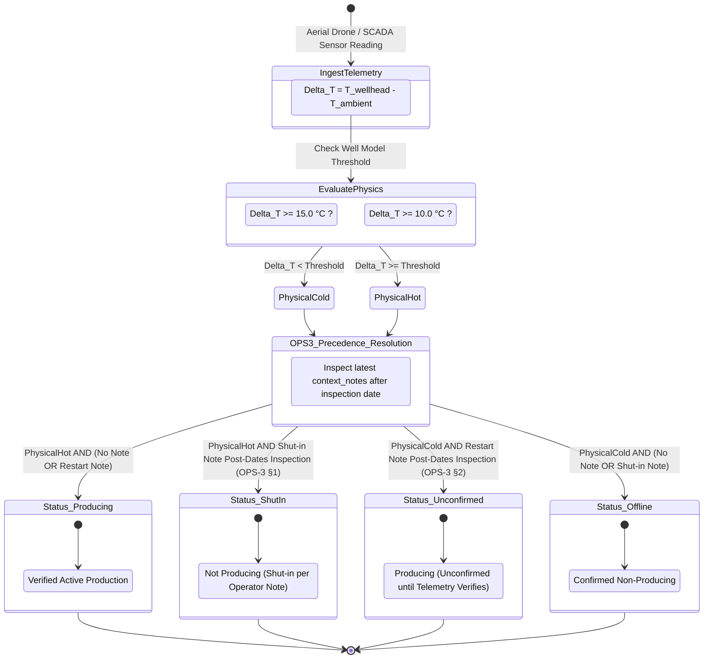
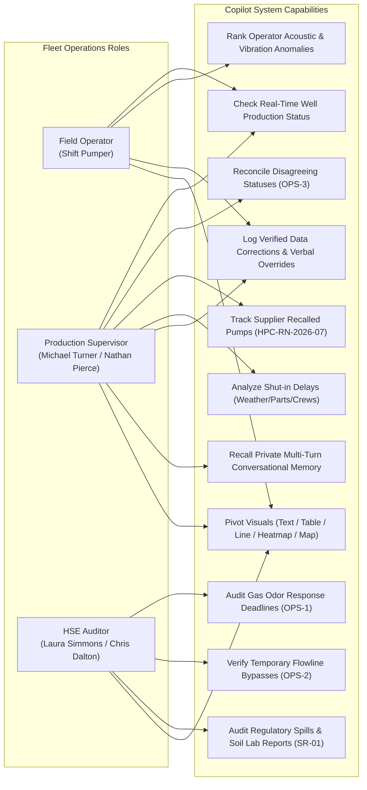
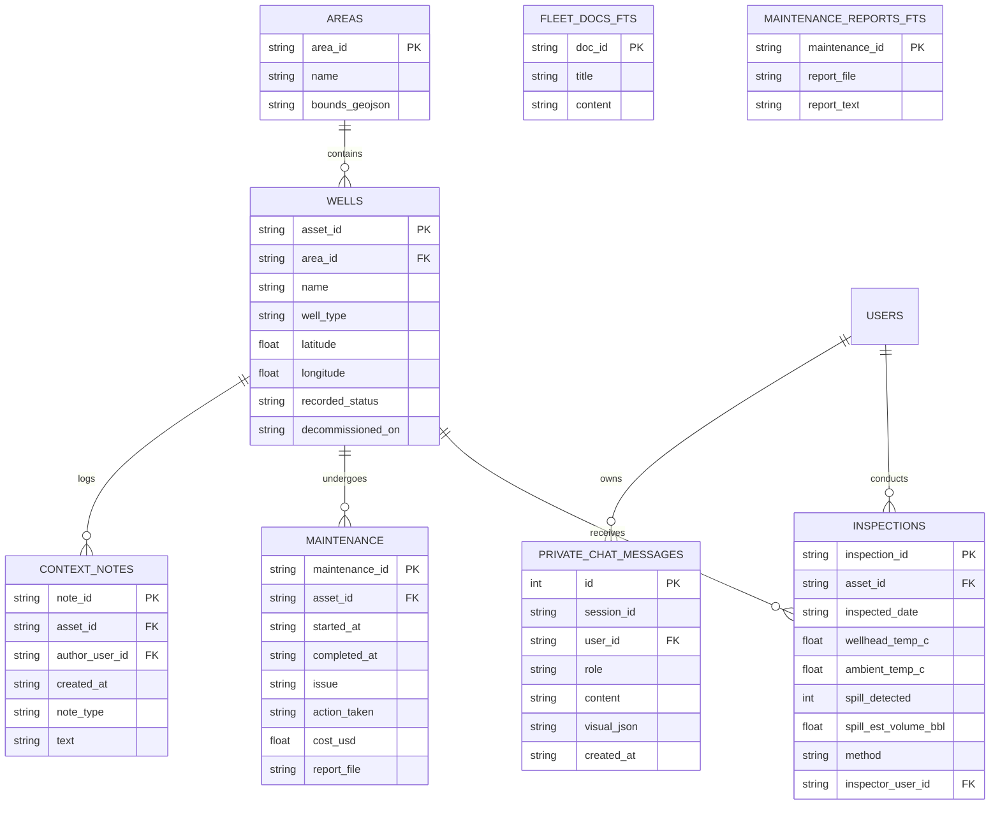

# 📐 FlytBase Asset Intelligence Copilot: UML & System Diagrams

This document contains the complete Unified Modeling Language (UML) specifications for the **FlytBase Asset Intelligence Copilot**. All diagrams are formatted in native GitHub-compatible **Mermaid** syntax.

---

## 1. System Component Diagram (UML Component)

Describes the modular decomposition of the frontend, backend services, security boundaries, and data tier.

---

## 2. Class Diagram (UML Class)

Illustrates the object-oriented structure, class relationships, and method signatures across the backend architecture.

```mermaid
classDiagram
    class AgentOrchestrator {
        -str db_path
        -LLMClient llm_client
        +process_query(user_id: str, session_id: str, query: str) CopilotResponse
        -_save_turn(session_id: str, user_id: str, query: str, resp: CopilotResponse) void
    }

    class CopilotResponse {
        +str answer_markdown
        +str visual_type
        +Any visual_data
        +List~str~ citations
        +Optional~str~ conflict_warning
        +List~str~ entities_discussed
        +List~str~ tools_called
    }

    class TruthEngine {
        +get_well_latest_status(asset_id: str) Dict
        +get_non_producing_wells_in_area(area: str) List
        +calculate_thermal_differential(t_wellhead: float, t_ambient: float) float
        +evaluate_production_threshold(well_type: str, delta_c: float) bool
    }

    class ConflictEngine {
        +audit_spill_detection_validity(asset_id: str, inspection_id: str) Dict
        +verify_user_claim(user_id: str, asset_id: str, claim: str) Dict
        +reconcile_inspector_notes(notes: List) Dict
    }

    class MemoryEngine {
        +save_private_chat_message(session_id: str, user_id: str, role: str, content: str) void
        +get_user_private_memory(user_id: str, lookback_days: int) Dict
        +record_fleet_truth_override(user_id: str, asset_id: str, field: str, value: Any) Dict
        +get_fleet_shared_overrides(asset_id: str) List
    }

    class ComplianceEngine {
        +audit_ops1_gas_odor_responses(since_date: str) Dict
        +audit_ops2_flowline_bypasses() Dict
        +audit_ops3_status_precedence() Dict
        +audit_ops5_freeze_protection() Dict
        +audit_regulator_spill_letters() Dict
    }

    class LLMClient {
        -str gemini_key
        -str openrouter_key
        -str model_name
        +generate_chat_response(system_prompt: str, messages: List) str
        +generate_structured_sql(query: str, schema_ddl: str) str
    }

    class SecurityGuardrails {
        +normalize_text_for_security_scan(text: str) str
        +check_prompt_injection(query: str) Tuple~bool, str~
        +check_sql_injection_attempt(query: str) Tuple~bool, str~
        +sanitize_response_for_leaks(response_text: str) str
        +log_security_event(event_type: str, severity: str, user_id: str, details: Dict) void
    }

    AgentOrchestrator --> LLMClient : delegates synthesis to
    AgentOrchestrator --> CopilotResponse : constructs
    AgentOrchestrator ..> TruthEngine : queries physical truth
    AgentOrchestrator ..> ConflictEngine : checks contradictions
    AgentOrchestrator ..> MemoryEngine : isolates/updates state
    AgentOrchestrator ..> ComplianceEngine : audits SOP rules
    AgentOrchestrator ..> SecurityGuardrails : enforces policies
```

---

## 3. Sequence Diagram: End-to-End Query Lifecycle (UML Sequence)

Traces the execution sequence of an operational audit query (e.g. Q3 Gas Odor Response Audit or Q6 Status Disagreement) through the security, reasoning, and storage subsystems.

---

## 4. State Machine Diagram: Well Status Derivation & OPS-3 Precedence (UML State)

Depicts how raw sensor telemetry, temperature delta physics, and operator handover notes transition a well's authoritative operational status.

---

## 5. Use Case Diagram (UML Use Case)

Illustrates user interactions by organizational role across the operational, environmental, and engineering domains.

---

## 6. Entity-Relationship (ER) Schema Diagram

Details the relational tables, primary/foreign keys, and virtual FTS5 indices supporting sub-second analytical retrieval.

